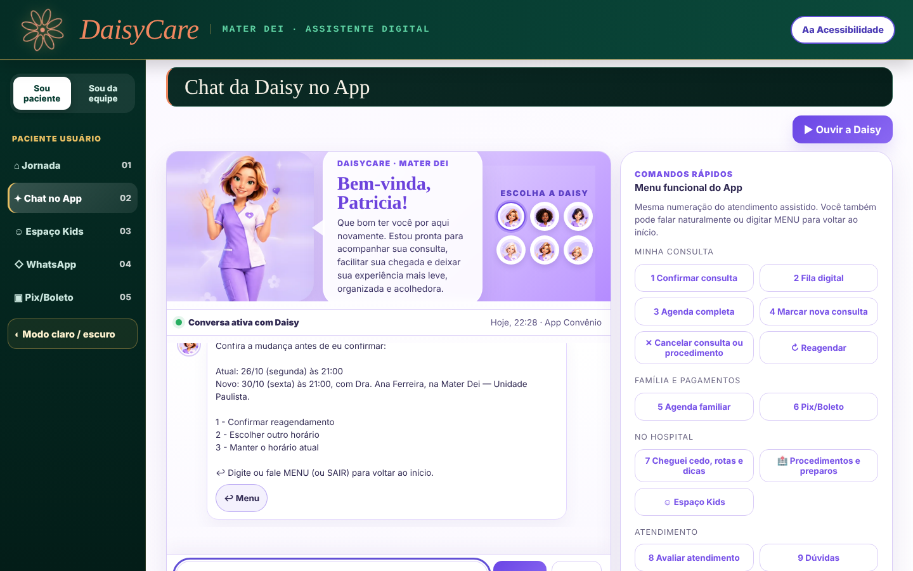
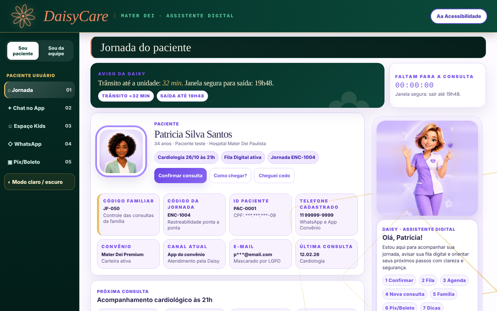
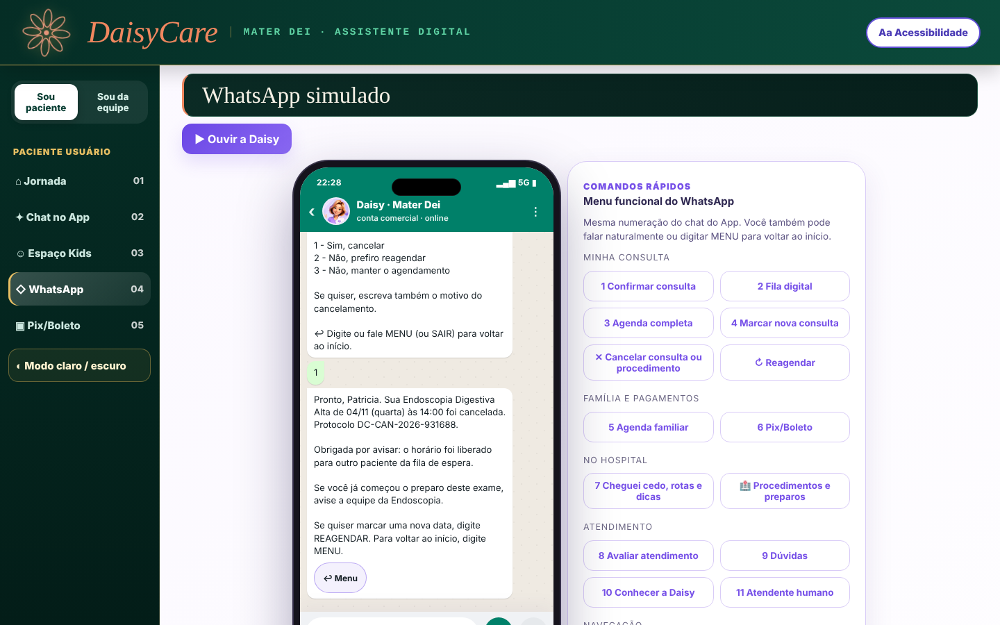
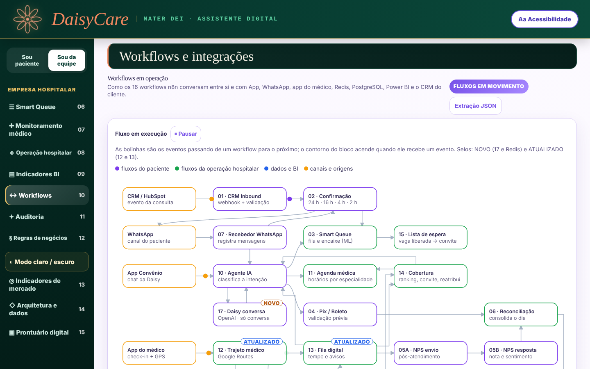
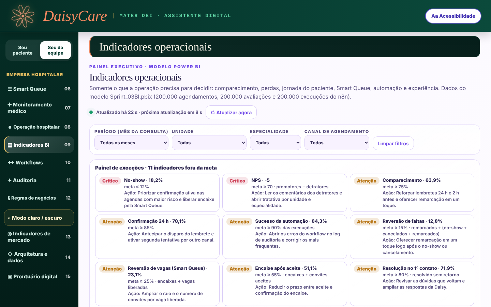
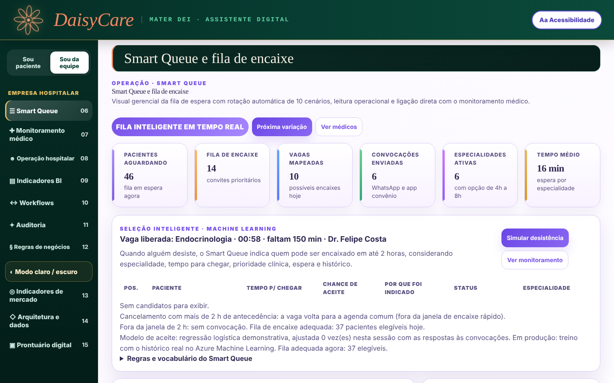
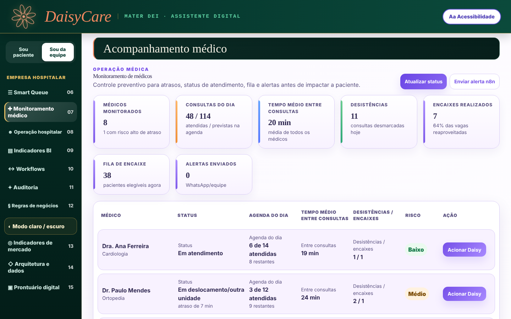

# DaisyCare Next · v40.93

**Assistente virtual que reduz faltas e reaproveita vagas na jornada do paciente.** A Daisy confirma, cancela e reagenda consultas pelo app e pelo WhatsApp, por texto e voz. Cada horário liberado vai para uma fila de encaixe, e cada evento chega ao Power BI.

> 🥇 **Medalha de ouro no FIAP NEXT 2026**: o DaisyCare foi premiado como a melhor solução entre 10 projetos.

Projeto em equipe (Data Bridge) do Challenge FIAP × Hospital Mater Dei (Data Science, 2026), premiado no **FIAP NEXT 2026**.

**▶ [Abrir a demo no navegador](https://rn2812.github.io/DaisyCare_Next/)** · [Pitch em PDF](docs/pitch/DaisyCare_Pitch_FIAP_NEXT_2026.pdf) · [Notebook de ML](analytics/ml/DaisyCare_ML_previsao_comparecimento.ipynb)

> Todos os dados são fictícios ou sintéticos. Não há dado real de paciente, CPF ou conversa gravada.



---

## O problema em números

Base sintética de **200 mil agendamentos em 10 hospitais** (set/2025 a ago/2026):

| Indicador | Valor |
|---|---|
| Consultas com falta (no-show) | **8,7%**, cerca de 16,8 mil |
| Vagas vazias somando faltas e cancelamentos | **27 mil** |
| Pacientes que não confirmam 24 h antes | **28%** |
| Faltas entre quem não confirma × quem confirma | **12% × 7%** |
| Encaixes realizados pela fila inteligente | **589** vagas recuperadas |

## O que a solução faz

| Frente | Na prática |
|---|---|
| **Atendimento (app e WhatsApp)** | Chat por texto e voz com 11 opções: confirmar, cancelar e reagendar (v40.93), fila digital, agenda familiar, Pix/boleto, preparo de exames, NPS e transbordo humano |
| **Smart Queue** | Vaga cancelada vira convite para o próximo paciente elegível da lista de espera |
| **Automação (n8n)** | 16 workflows ligados por eventos: confirmação, encaixe, trajeto do médico (Google Routes), fila digital, cobertura de agenda, indicadores e conversa com IA |
| **Dados e BI** | Eventos com `correlation_id` no PostgreSQL, tempo real no Redis, painel executivo com medidas DAX |
| **Machine Learning** | Modelo de previsão de comparecimento (AUC 0,70, F1 0,70) para priorizar quem recebe contato extra |
| **Governança e LGPD** | 36 regras de negócio documentadas, CPF e e-mail mascarados, sem decisão clínica, trilha de auditoria |

## Competências demonstradas

- **Análise de dados e BI:** modelagem de indicadores (no-show, reversão de faltas, reversão de vagas, receita recuperada), DAX, painel executivo com exceções por meta.
- **Machine Learning:** EDA, tratamento de outliers (IQR), pipeline scikit-learn, comparação de 3 algoritmos com validação cruzada, tuning, análise de threshold e de desempenho por segmento.
- **Engenharia e automação:** fluxos n8n orientados a eventos, PostgreSQL, Redis, Docker, integração com APIs (Google Routes, OpenAI).
- **Qualidade:** 124 checagens automatizadas com Playwright e build reproduzível com conferência de SHA-256.
- **Produto:** regras de negócio, jornada do paciente, acessibilidade (zoom, alto contraste, voz) e pitch executivo.

## Como rodar

**No navegador:** abra a [demo publicada](https://rn2812.github.io/DaisyCare_Next/), sem instalar nada.

**Windows:** abra `app/Iniciar_DaisyCare.bat`. O Chrome abre em `http://localhost:8765`.

**Qualquer sistema:**

```bash
cd app
python3 -m http.server 8765
# abra http://localhost:8765/DaisyCare_App_v40_93_Voz_Natural.html
```

Clique em **"Ativar voz oficial Daisy"** uma vez para liberar o som. Para testar a novidade da v40.93, digite no chat `1`, `cancelar a endoscopia` ou `reagendar`.

## Testes

```bash
pip install playwright && playwright install chromium
python3 testes/regressao.py   app/DaisyCare_App_v40_93_Voz_Natural.html   # 105 checagens
python3 testes/t93_agenda.py  app/DaisyCare_App_v40_93_Voz_Natural.html   # 19 checagens (confirmar, cancelar, reagendar)
```

## Build a partir do código-fonte

```bash
python3 fonte/build/build_v93.py
```

O script monta a v40.91 a partir da base e dos módulos `v*.js`, aplica as mudanças das versões 40.92 e 40.93 e confere o SHA-256 do arquivo gerado com a versão publicada.

## Estrutura

```
app/            aplicativo pronto (HTML único + falas mp3 + servidor local)
fonte/          código-fonte do build (base, módulos JS, patches)
testes/         suítes Playwright (testes/historico: scripts das versões 80 a 91)
n8n/            workflows 12 a 17 para importar no n8n
analytics/      notebook de Machine Learning, bases sintéticas e medidas DAX
docs/           pitch em PDF, manual dos workflows n8n, telas e roteiros de voz
```

## Telas

| Jornada do paciente | WhatsApp: cancelamento com protocolo |
|---|---|
|  |  |
| **Workflows n8n em execução** | **Indicadores operacionais** |
|  |  |
| **Smart Queue** | **Acompanhamento médico** |
|  |  |

Apresentação completa: [docs/pitch/DaisyCare_Pitch_FIAP_NEXT_2026.pdf](docs/pitch/DaisyCare_Pitch_FIAP_NEXT_2026.pdf)

## Premiação

O DaisyCare recebeu a **medalha de ouro no FIAP NEXT 2026**, como a melhor solução entre 10 projetos apresentados.


## Limitações e próximos passos

- As datas da paciente de teste são fixas (consulta de cardiologia em 26/10/2026) porque as falas gravadas citam essas datas. Depois dessa data, a contagem regressiva da tela inicial fica zerada.
- Respostas de cancelar e reagendar ainda não têm áudio gravado (só texto).
- Os workflows 12 a 17 seguem a estrutura do n8n, mas ainda não rodaram em uma instância real.
- O destino do mapa é um ponto de exemplo, porque a unidade Mater Dei Paulista ainda não existe.

Histórico de versões: [CHANGELOG.md](CHANGELOG.md)

---

**Rodrigo Nillo** · Analista de Dados e BI · [LinkedIn](https://www.linkedin.com/in/rodrigo-nillo/) · [rodrigo.nillo86@gmail.com](mailto:rodrigo.nillo86@gmail.com) · [Outros projetos](https://github.com/Rn2812)
