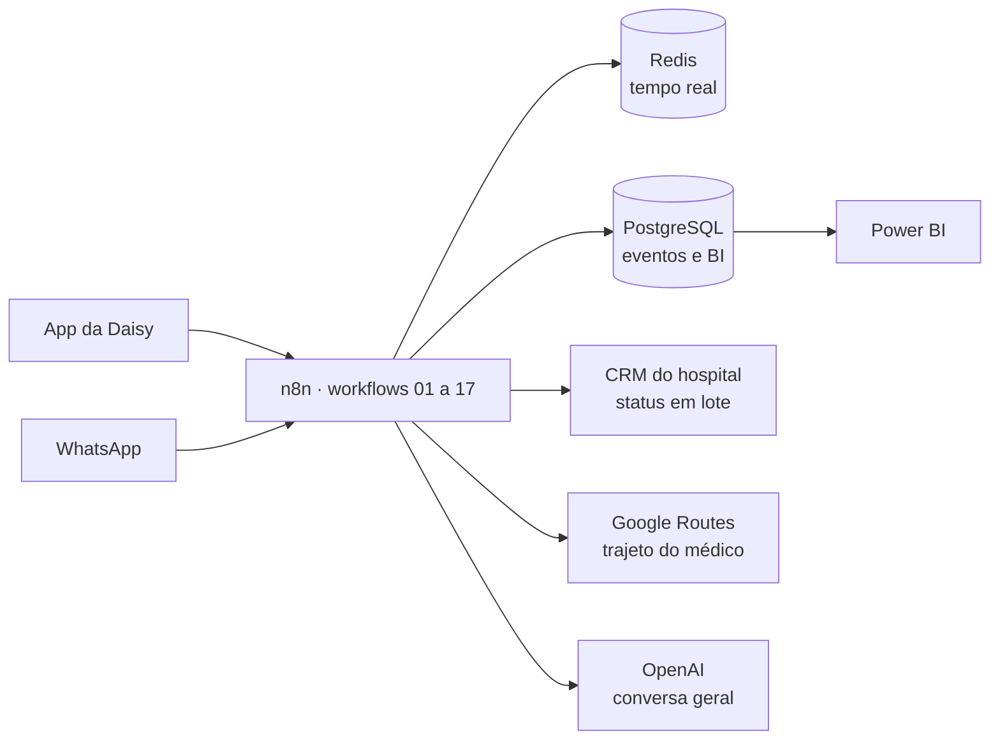

# DaisyCare Next

**Assistente virtual que reduz faltas e reaproveita vagas na jornada do paciente.**
A Daisy confirma a consulta, encaixa o próximo paciente quando alguém cancela e orienta sobre preparo, fila e rota, no app e no WhatsApp, por texto ou por voz.


Projeto do Challenge FIAP × Hospital Mater Dei (Data Science, 2026), apresentado no **FIAP NEXT 2026**.

---

## O problema

Em uma base sintética de 200 mil agendamentos em 10 hospitais, **8,7% das consultas terminam com a cadeira vazia**. O hospital só descobre a falta na hora da consulta, a vaga cancelada não é reocupada e o paciente não sabe quando o médico está atrasado.

## A solução

| Frente | O que a Daisy faz |
|---|---|
| **Confirma** | Lembretes antes da consulta; confirmar, cancelar ou reagendar pelo chat |
| **Encaixa** | Vaga cancelada vai para a fila de espera e é oferecida a quem chega a tempo |
| **Orienta** | Preparo e jejum, posição na fila digital, rota até o hospital e rotas internas |
| **Protege** | Nome + CPF antes de Pix, boleto ou nova consulta; nada clínico é decidido pela Daisy; atendente humano a qualquer momento |

## Demonstração

| Caminho | Como abrir |
|---|---|
| **Windows** | Baixe o repositório, abra `app/` e dê dois cliques em `Iniciar_DaisyCare.bat`. O Chrome abre em `http://localhost:8765`. |
| **Outros sistemas** | `cd app && python3 -m http.server 8765` e abra `http://localhost:8765/DaisyCare_App_v40_93_Voz_Natural.html` |

Clique em **Ativar voz oficial Daisy** uma vez para liberar o áudio. Experimente no chat: `1` (confirmar consulta), `REAGENDAR`, `cancelar a endoscopia`, `0` (ouvir as opções).

## Arquitetura



Todo evento grava o mesmo `correlation_id`, do canal ao Power BI. Os workflows 12 a 17 (modelo Ouro) estão em [`n8n/`](n8n/).

## Estrutura do repositório

```
DaisyCare_Next/
├── app/                      Aplicativo pronto para rodar (v40.93)
│   ├── DaisyCare_App_v40_93_Voz_Natural.html
│   ├── falas/                Áudios da Daisy (falas/auto = respostas completas)
│   ├── Iniciar_DaisyCare.bat
│   └── servidor_daisycare.ps1
├── n8n/
│   ├── README.md             Como importar e como os fluxos se ligam
│   └── workflows/            JSON dos workflows 12 a 17
├── fonte/
│   ├── base/                 HTML base (v40.51)
│   └── build/                Módulos JS/Python que geram o app
├── testes/
│   ├── regressao.py          107 verificações automáticas (Playwright)
│   └── pontuais/             Testes de versões específicas (v40.80 a v40.91)
├── docs/
│   ├── apresentacao/         Pitch FIAP NEXT 2026 (.pptx)
│   └── roteiros-falas/       Roteiros usados para gravar as vozes
└── CHANGELOG.md
```

## Testes

```bash
pip install playwright && playwright install chromium
python testes/regressao.py app/DaisyCare_App_v40_93_Voz_Natural.html
```

A suíte sobe um servidor local e verifica chat, voz, acessibilidade, layout em celular, regras de negócio (RN-01 a RN-36), workflows e ausência de erros na página. Resultado na v40.93: **107/107 OK**.

## Tecnologias

HTML/CSS/JavaScript · Python · Playwright · n8n · PostgreSQL · Redis · Power BI · Google Routes API · OpenAI API · Docker

## Limitações conhecidas

- Os dados (pacientes, agendas, indicadores) são **fictícios ou sintéticos**. Nenhuma conversa ou CPF é gravado.
- Os workflows n8n seguem a estrutura padrão de importação, mas não foram executados em um servidor de produção.
- O build em `fonte/` reproduz o app até a v40.91; as mudanças da v40.92 e v40.93 estão no HTML publicado em `app/`.
- Respostas de cancelar e reagendar (v40.93) ainda são só em texto, sem áudio gravado.
- O destino do mapa é um ponto de exemplo.

## Autor

**Rodrigo Nillo** · Analista de Dados e BI · Data Science FIAP

[](https://www.linkedin.com/in/rodrigo-nillo/)
[](https://github.com/Rn2812)
[](mailto:rodrigo.nillo86@gmail.com)
