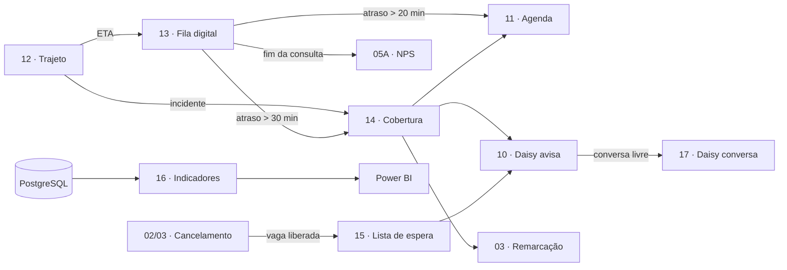

# Workflows n8n · modelo Ouro (12 a 17)

Os seis workflows abaixo complementam os fluxos 01 a 11 do MVP (atendimento, agenda, NPS e Agente IA). Cada um grava um evento com `correlation_id` no PostgreSQL, o que permite rastrear a jornada do canal ao Power BI.

| # | Workflow | Nós | O que faz |
|---|---|---|---|
| 12 | [Trajeto do médico](workflows/daisycare_12_trajeto_medico.json) | 21 | Recebe check-in e GPS do app do médico, guarda a posição no Redis e consulta o Google Routes com intervalo adaptativo (1 a 5 min). Se houver atraso ou incidente, aciona a cobertura (14). |
| 13 | [Fila digital](workflows/daisycare_13_fila_digital.json) | 17 | Mantém a fila de cada médico no Redis, prevê a espera pela mediana das últimas 20 consultas e avisa o paciente quando a previsão muda. Atraso > 20 min reorganiza a agenda; > 30 min pede cobertura. |
| 14 | [Cobertura de agenda](workflows/daisycare_14_cobertura_agenda.json) | 13 | Ranqueia profissionais em sobreaviso, convida por app e WhatsApp, aguarda 5 min e reatribui a agenda ou oferece telemedicina/remarcação. |
| 15 | [Lista de espera e encaixe](workflows/daisycare_15_lista_espera.json) | 12 | Quando uma vaga é liberada, escolhe quem convidar da lista de espera, aguarda 10 min e passa para o próximo se não houver aceite. |
| 16 | [Indicadores de sucesso](workflows/daisycare_16_indicadores_sucesso.json) | 8 | A cada hora calcula no-show, eficiência do encaixe e receita preservada, envia ao Power BI e alerta a gestão abaixo da meta. |
| 17 | [Daisy conversa](workflows/daisycare_17_daisy_conversa.json) | 14 | Dúvidas gerais com OpenAI: mascara dados, detecta urgência, modera entrada e saída e responde só com base aprovada (RAG). Sem acesso a agenda, Pix ou CRM. |

## Como os fluxos se ligam

## Como importar

1. No n8n: **Workflows → Import from file**, um arquivo por vez. Todos entram desativados.
2. Crie as credenciais **PostgreSQL** e **Redis** e selecione-as nos nós correspondentes (credenciais nunca vão no arquivo).
3. Defina as variáveis de ambiente:

   | Variável | Uso |
   |---|---|
   | `N8N_BASE_URL` | Chamadas entre workflows |
   | `GOOGLE_MAPS_API_KEY` | Workflow 12 (Google Routes) |
   | `OPENAI_API_KEY`, `OPENAI_MODEL` | Workflow 17 |
   | `TICKET_MEDIO` (opcional) | Workflow 16 (receita preservada) |

4. Ajuste as tabelas (`ops.*`, `audit.evento_integracao`) aos nomes reais do seu banco.
5. Ative primeiro os que recebem chamadas (14, 15 e 17) e depois 12, 13 e 16.

## Cuidados

- Sem CPF e sem dado clínico nos eventos; ids de paciente pseudonimizados.
- Receita recuperada é estimativa; metas e pesos do ranking são sugestões a validar com o hospital.
- Estrutura padrão de importação do n8n, mas não executada em produção. Teste em ambiente de homologação.
